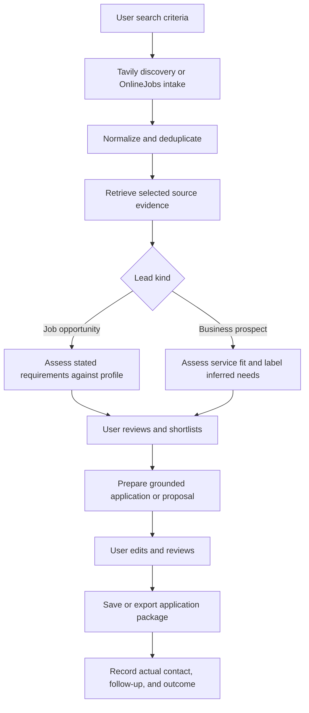

# Fresh local freelancer CRM with Tavily discovery

Date: 2026-10-11

Status: Design and implementation sequence. The new application has not been implemented.

## Agreed outcome

Build a fresh local-first application that discovers both advertised work and potential client businesses, qualifies each against the user's professional profile, prepares a grounded application or proposal, and tracks follow-ups and outcomes.

The user selected both job opportunities and direct business leads for the first working version. Existing professional facts, CV text, portfolio links, saved listings, notes, stages, assessments, and edited drafts are migration inputs, not disposable prototype data.

## Discovery providers

| Provider | Purpose | Initial decision | Trade-off |
| --- | --- | --- | --- |
| Tavily Search + Extract | Find public company pages, career pages, advertised opportunities, and supporting evidence; retrieve selected page content | Primary general-web provider | Remote API key and usage; search coverage and extraction completeness must be checked |
| Existing OnlineJobs scraper | Collect structured postings, source posting dates, and full descriptions | Retain as a dedicated source adapter | Requires maintenance when that site's layout changes |
| Crawl4AI | Local browser crawling, Markdown conversion, and CSS/XPath extraction for dynamic sites | Preferred next crawler when actual extraction failures require it | Browser installation, machine resources, and site-specific maintenance |
| Playwright | Fine control of interactions on a specific dynamic site | Use for a source that needs custom interaction | Lower-level browser automation; we implement parsing and crawl policy |
| Firecrawl | Managed page/site extraction into clean content | Optional alternative to maintaining more local crawling | Another remote provider and usage budget; overlaps Tavily extraction and Crawl4AI |
| Apify Actors | Source-specific hosted collection where an appropriate actor exists | Evaluate per source later | Third-party actor quality, configuration, maintenance, and usage costs |

Start with Tavily and OnlineJobs. Tavily already has extraction; adding multiple overlapping providers at startup would complicate cost accounting and failure handling before real coverage gaps are known.

Useful additional sources are public company services/contact/careers pages and structured company job feeds where an API or feed is available. Evaluate source availability individually. A scraper tool does not guarantee access to every website.

Tavily settings should expose bounded query/result limits, optional domain and date filters, extraction scope, and visible provider usage. Cache retrieved pages and avoid repeated extraction of unchanged evidence. A search ranking score is relevance to a query, not a lead-fit score or evidence of buying intent.

## Proposed runtime

- React + TypeScript + Vite for the new local interface, with the production bundle served by the local backend. This is a frontend recommendation, not a requirement to reuse the legacy Next.js app.
- FastAPI for the local backend, bound to loopback.
- SQLite for CRM data, with explicit schema migrations and consistent backups.
- LangGraph for selected multi-step workflows, SQLite checkpoints, conditional routing, and durable review pauses.
- Existing Agents SDK integrations for AI qualification and drafting, adapted behind the AI module. A workflow controller does not provide model authentication.
- A local worker for bounded discovery/crawl runs, cancellation, progress, and partial results. Network work does not hold database transactions open.

Tavily credentials and usage are independent of the AI connection. Keep secrets in protected local runtime storage outside source control, browser state, the CRM database, and logs. Use deterministic parsers where the page structure is known; only use AI for tasks that require interpretation or writing.

## Data model

**Organization**: a business and its verified public website/domain, with known attributes and linked source evidence. Shared by related leads when an identity match is supported.

**Lead**: either `job_opportunity` or `business_prospect`, with a title, organization if known, source identity, pipeline stage, notes, and next action. An unknown employer stays unknown. One organization can have several job opportunities or different proposed engagements.

**Source evidence**: source URL, provider, retrieved time, original content snapshot, publication date if supplied, content completeness, and content hash. Never substitute discovery time for a job's posting date. Mark stale evidence explicitly.

**Professional profile**: the user's saved skills, services, work experience, projects, education, certifications, links, CV text, and optional preferences. Preserve missing availability/rate preferences rather than inventing them. The rebuilt editor should make projects and certifications individually editable instead of flattening everything into experience lines.

**Qualification**: an assessment version with its profile/source snapshots, cited fit evidence, gaps, unknowns, suggested next action, and an explicit distinction between observed facts and inferred needs. Persist the model and input identities.

**Application package**: editable cover letter, proposal, outreach draft, and optional CV suggestions, with version history and review state. Human edits remain separate from the generated source snapshot. A full CV/PDF document is a later extension of this model, not implied by a text draft.

**Activity**: an actual shortlist, stage change, user-recorded contact/submission, reply, follow-up, or outcome, with time and optional note. Generating text does not record an application as submitted.

**Discovery run / workflow run**: bounded search configuration, per-provider counts/usage, progress, failures, and cancellation. Keep the workflow checkpoint identity separate from the CRM lead ID so repeated workflows have separate histories.

Deduplicate advertised work by provider posting identity where available, otherwise by canonical source URL. Match organizations using verified canonical domain and additional identity evidence; matching organization names alone must not merge unrelated records. Preserve separate postings from a company's different recruitment systems.

## First workflow



Keep two explicit discovery modes. In jobs mode, a result must support an advertised position before becoming a job opportunity. In prospect mode, a company page can become a business prospect without a claim that the company is hiring. Prefer an explicit user-selected kind for ambiguous results and leave inferred engagement opportunities visible as hypotheses.

For business prospects, qualification separates profile/service fit, a source-supported need signal, contact-channel availability, and budget/timing unknowns. A public email address is not a verified decision maker. Never fabricate contacts, funding, hiring intent, problems, or outcomes.

Use LangGraph review interrupts for deliberate user decisions, with a stable workflow run ID and durable checkpoints. Generation runs should use exact profile/evidence snapshots. Validate a resumed workflow against intervening user edits. Persist writes with stable operation identities because a paused node may execute again when resumed.

## New layout

```text
crm/
  backend/
    app/
      discovery/       # Tavily and OnlineJobs adapters
      leads/           # organizations, lead kinds, evidence, intake
      profiles/        # professional facts and preferences
      workflows/       # LangGraph orchestration
      ai/              # qualification, drafting, provider/session adapters
      documents/       # versions, edits, review, exports
      activities/      # pipeline history, follow-ups, outcomes
      database/        # SQLite schema, migrations, backups
    tests/
  frontend/
  README.md
```

This is a proposed directory structure. The current running experiment remains at `experiments/chatgpt_plan`; no replacement files are created by this design document.

## Implementation sequence and acceptance

1. **Foundation and migration**: establish the new local app, schema, profile editor, and lead inbox. Back up the current experiment with SQLite's backup API and import its ordinary data into a new database. Verify all real lead/profile records and preserve user edits. Keep the existing app available during migration verification. Preserve legacy PostgreSQL history through a separate explicit migration if it is needed; an experiment import is not a legacy migration.

2. **Tavily discovery**: add a settings interface for its API key, bounded jobs/prospects searches, domain/date filters, Search/Extract adapters, source snapshots, duplicate handling, progress, cancellation, provider usage, and partial-result errors. Repeated searches must not duplicate leads or reset stages/notes. Failed extraction leaves a visibly incomplete lead. Verify both successful and failed extraction entries even after HTTP 200.

3. **Existing source integration**: adapt OnlineJobs into the same intake interface. Preserve complete descriptions, canonical posting identity, source dates, crawl policy/pacing, cancellation, and partial results.

4. **Shared qualification and drafting**: wrap existing grounded AI calls in a selected-lead graph, using separate instructions for job requirements and prospect hypotheses. Pause for shortlisting and review; save validated output, snapshots, revisions, and versions. Demonstrate resume after restart without duplicating drafts or activities.

5. **CRM follow-up**: introduce inbox, shortlisted, preparing, contacted/applied, replied, discussion, won, lost, and skipped stages with recorded changes. Allow a next follow-up date and manual contact/reply logging. Separate user-recorded sending from draft preparation. Verify that activities and drafts stay attached across stage changes.

6. **Complete application documents**: integrate deterministic CV assembly, full CV/PDF export, optional proposal PDFs, and document revision. Preserve the existing no-invention rule, one-page CV rule, and ATS checks. Give the user editable source and version history.

7. **Additional crawling and packaging**: add Crawl4AI or another provider for measured gaps, then improve local installation and backups. Reconsider a hosted deployment only when requested; local scheduled runs require a running computer and worker.

The first end-to-end milestone completes steps 1-5 for both lead kinds with editable text exports. Step 6 restores the broader CV/PDF capability; finishing the first milestone must not be described as finishing the full original feature set.

## Validation priorities

- Migration preserves actual profile content, lead identity, notes/stages, assessment snapshots, draft generations, and human edits; re-importing is safe.
- Provider errors distinguish unavailable key, exhausted usage, rate limits, transient network failure, partial extraction, and invalid content without logging secrets.
- A business prospect never silently becomes a confirmed hiring opportunity; search relevance never becomes buying intent.
- Date ordering uses source posting dates, with unknown dates retained explicitly.
- Cancellation stops additional requests and preserves completed intake without saving partial AI drafts.
- Review/resume detects stale source/profile and edit conflicts, and restart/replay does not duplicate persistent actions.
- A reviewed draft contains traceable source/profile evidence and retains human edits across regeneration.

Live Tavily validation requires an actual API key entered into local settings. Offline fixtures validate request/response handling; they do not establish live source coverage or provider entitlement.

## Sources reviewed

- [Tavily Search](https://docs.tavily.com/documentation/api-reference/endpoint/search)
- [Tavily Extract](https://docs.tavily.com/documentation/api-reference/endpoint/extract)
- [Crawl4AI quickstart](https://docs.crawl4ai.com/core/quickstart/)
- [Playwright Python library](https://playwright.dev/python/docs/library)
- [Firecrawl introduction](https://docs.firecrawl.dev/introduction)
- [Apify platform](https://docs.apify.com/platform)
- [LangGraph overview](https://docs.langchain.com/oss/python/langgraph/overview)
- [LangGraph persistence](https://docs.langchain.com/oss/python/langgraph/persistence)
- [LangGraph review interrupts](https://docs.langchain.com/oss/python/langgraph/interrupts)
